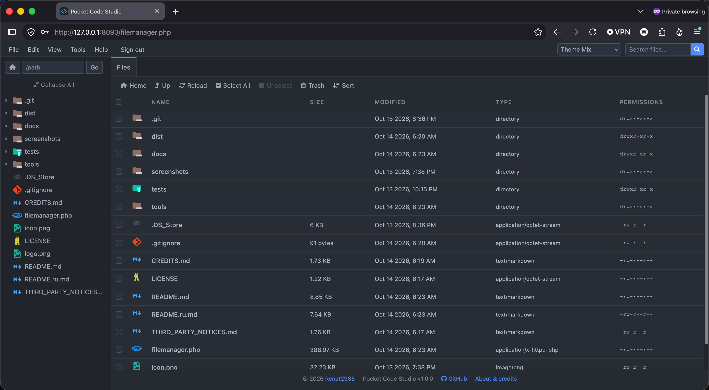
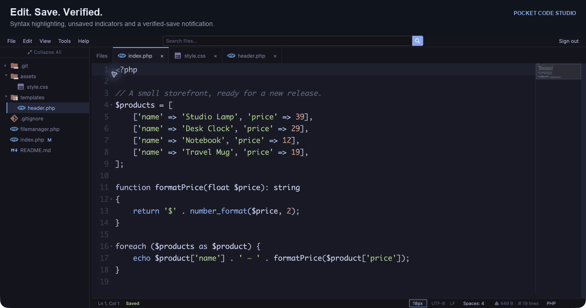
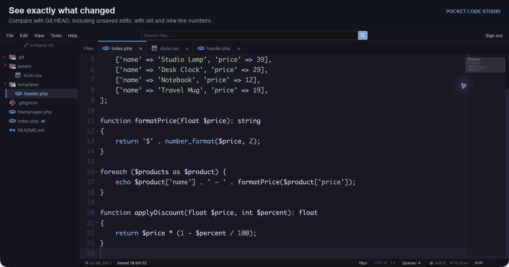

# Pocket Code Studio

Файловый менеджер и редактор кода в одном PHP-файле с интерфейсом, вдохновлённым Visual Studio Code.

[English](README.md) · [Ошибки и предложения](https://github.com/Renat2985/pocket-code-studio/issues)



## Возможности

- Дерево файлов, изменяемая ширина панели, вкладки и восстановление позиции курсора и прокрутки.
- Подсветка синтаксиса, поиск/замена, форматирование, перенос строк и несколько курсоров.
- Минимап, отметки повторений, иконки файлов и темы всего интерфейса.
- Создание, переименование, копирование, перенос, загрузка/скачивание, корзина/восстановление, права доступа и архивы при поддержке сервером.
- Статус Git, сравнение с HEAD, коммиты выбранных файлов и push на GitHub.
- Мобильный интерфейс с компактным меню и кнопками для ввода кода.
- Авторизация по паролю, защита CSRF, ограничение попыток входа и проверенное сохранение с резервными копиями.

- В списке изменений больше нет ограничения 500 файлов. Для одного коммита можно выбрать до 2000 файлов: до 32 МБ на файл и 128 МБ суммарно. Хеши содержимого вычисляются только для выбранных файлов. Push existing commits не сканирует рабочие файлы.

<details>
<summary>Посмотреть редактирование и Git diff</summary>





</details>

## Требования

- PHP **7.4+**, сессии, права записи в рабочую и временную папки. Рекомендуется поддерживаемая версия PHP.
- HTTPS; для локального loopback-адреса не требуется. На Apache/Nginx PHP должен получать `HTTPS=on` при TLS-запросах.
- Интернет в браузере: библиотеки JavaScript/CSS загружаются с CDN.
- Необязательно: Git и PHP `proc_open`; расширения или инструменты для нужных архивов.

База данных, Composer и сборка Node.js не нужны.

## Установка

1. Загрузите **`filemanager.php`** — остальные файлы приложения на сервере не нужны.
2. Начальная рабочая папка — корень сайта; изменить её можно через **File → Settings → Workspace root → Browse…**.
3. Откройте файл по HTTPS. Начальный пароль — **`admin123`**, имя пользователя не требуется.
4. Сразу смените пароль в **File → Settings**, прежде чем открывать публичный доступ к менеджеру.

Чтобы задать свой пароль до загрузки, создайте хеш локально и вставьте его в `$authPasswordHash`:

```sh
php -r 'echo password_hash(readline("New password (input is visible): "), PASSWORD_DEFAULT), PHP_EOL;'
```

При замене PHP-файла сохраняйте свой хеш пароля и настройки. Не публикуйте настроенную копию рабочей установки.

## Управление и настройки

**Edit → Copy / Move / Rename / Delete** применяется к файлу активной вкладки или к выделенным элементам в Files. Перед этими операциями сохраните несохранённые правки редактора.

- **Ctrl/⌘ S:** сохранить. **Ctrl/⌘ + нажатие:** добавить курсор. **Escape:** оставить один курсор.
- **View → Show Changes Since Save:** подсветка добавленных и удалённых строк; сравнение обновляется после подтверждённого сохранения.
- **View → Color theme:** 43 темы Ace; цвета интерфейса подстраиваются под выбранную тему. Язык и размер шрифта редактора — в нижней строке состояния.
- **File → Settings:** часовой пояс, формат даты, размер шрифта интерфейса и необязательная смена пароля. Доступно определение часового пояса браузером. Формат даты по умолчанию: `M j Y, H:i:s`.
- **Browse…** в Copy/Move выбирает существующую папку назначения внутри рабочего пространства. В настройках корня можно просматривать другие папки, доступные PHP с учётом ограничений хостинга. Перед сменой корня сохраните открытые файлы.
- **Save Settings** сохраняет все изменения вместе; **Cancel** отменяет их. Пустые поля пароля оставляют прежний пароль.

Настройки хранятся в `filemanager.php`; PHP нужны права на его замену. Значения старого `.fm-config` переносятся при следующем сохранении настроек.

## Авторизация

- Вход только по паролю; начальный пароль — **`admin123`**. Замените его в **File → Settings**. В PHP-файле хранится хеш пароля, а не сам пароль.
- Ограничение перебора по умолчанию: **8 ошибок с одного IP** или **64 ошибки со всех IP** блокируют следующие попытки входа до конца соответствующего **15-минутного окна**. Окно начинается с первой записанной ошибки. Общий лимит может временно заблокировать всех, включая владельца.
- **Tools → Login activity:** IP-адреса, результаты входа, сведения о браузере, активные блокировки и сброс лимита для IP или всех адресов. Здесь же меняются лимиты. После входа уведомление показывается один раз и только при наличии заблокированных IP.
- Приватное хранилище сервера: `sys_get_temp_dir()/fm-auth-<installation-id>/`. `attempts.json` содержит счётчики с SHA-256-ключами и записанными IP; `login-activity.json` хранит до **7 дней / 2 000 записей / 1 МБ**, а `login-policy.json` — выбранные лимиты. Пароли не записываются. Повторные заблокированные запросы объединяются; статистика строится по сохранённым записям. Исходные IP старых счётчиков с одними хешами неизвестны.
- Очистка cookies не сбрасывает серверные счётчики; очистка временных файлов хостингом может удалить счётчики, историю и выбранные лимиты. PHP использует `REMOTE_ADDR`; передачу правильного адреса через доверенный прокси нужно настроить на сервере.
- Сессия истекает после **30 минут бездействия** или **12 часов с момента входа**. Cookies имеют HttpOnly и SameSite=Strict, а при HTTPS — Secure. Смена пароля завершает другие сессии. Запросы, меняющие данные, требуют CSRF-токен.
- Это ограничение подбора пароля, **не защита от DDoS**. Ограничение потока запросов на уровне хостинга или веб-сервера настраивается отдельно.

## Важные ограничения

- Пароль защищает только запросы через менеджер; публичные URL сайта остаются публичными.
- Редактор принимает текст UTF-8 до **8 МБ**. Бинарные файлы, смешанные переводы строк и жёсткие ссылки не обрабатываются. UTF-8 BOM и единые окончания строк LF/CRLF/CR сохраняются.
- Сохранение проверяет версию файла на диске и создаёт проверенные приватные резервные копии. Хостинг может очистить временные копии; они не заменяют постоянные бэкапы. Внешняя запись может совпасть по времени с сохранением; ACL и расширенные атрибуты файлов могут не сохраниться при замене.
- Сохранение не проверяет синтаксис кода. Несохранённый текст документа не восстанавливается после перезагрузки.
- Для Git рабочая папка должна совпадать с корнем существующего репозитория хотя бы с одним коммитом. В **Tools → GitHub: Commit & Push** укажите HTTPS-адрес GitHub, текущую ветку, автора и fine-grained токен (Contents: Read and write; для workflow-файлов может потребоваться Workflows). Приватные репозитории поддерживаются.
- Токен хранится с доступом только владельцу в приватной временной папке авторизации, отдельно для каждой рабочей папки. В браузер он не возвращается; очистка временных файлов удалит его. Пустое поле сохраняет токен; смена репозитория удаляет прежний, если не введён новый.
- Выберите сохранённые файлы, введите сообщение и нажмите Commit & Push. Если отправка завершилась ошибкой или её результат неизвестен, обновите список и используйте Push existing commits. Уже подготовленные изменения, конфликты, символические ссылки и Git clean-фильтры требуют отдельного Git-клиента. Автоматического pull, force push, переключения веток и полосок Git возле строк нет.

## Авторство и поддержка

Основа — [PHP File Manager](https://github.com/JosephChuks/php-file-manager-with-code-editor) и [CWP Code Editor](https://github.com/JosephChuks/cwp-codeEditor) от Joseph Chuks. Редактор работает на Ace. Проект независим от Microsoft; расширения VS Code не поддерживаются.

[Благодарности](CREDITS.md) · [Лицензия](LICENSE) · [Уведомления сторонних компонентов и сведения о лицензии исходного проекта](THIRD_PARTY_NOTICES.md)

Ошибки и предложения: [GitHub Issues](https://github.com/Renat2985/pocket-code-studio/issues). Установка и индивидуальные доработки: [Renat2985](https://github.com/Renat2985).
